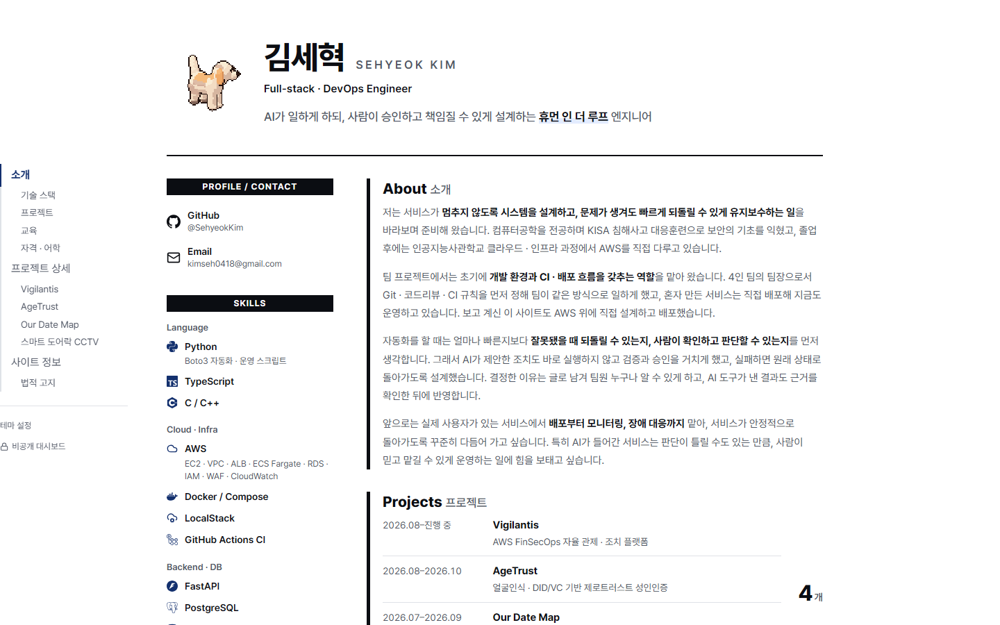
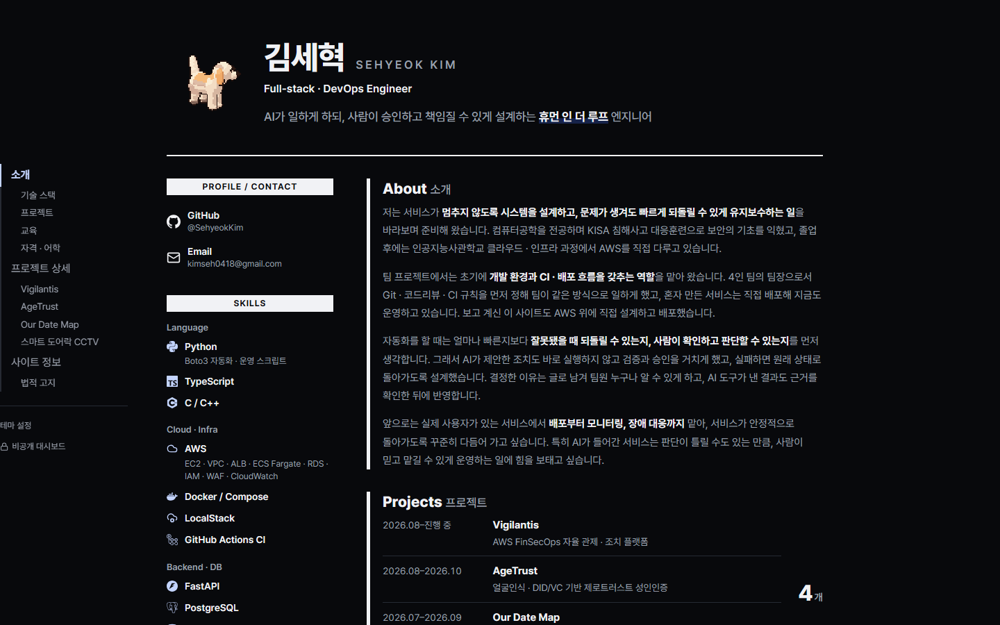
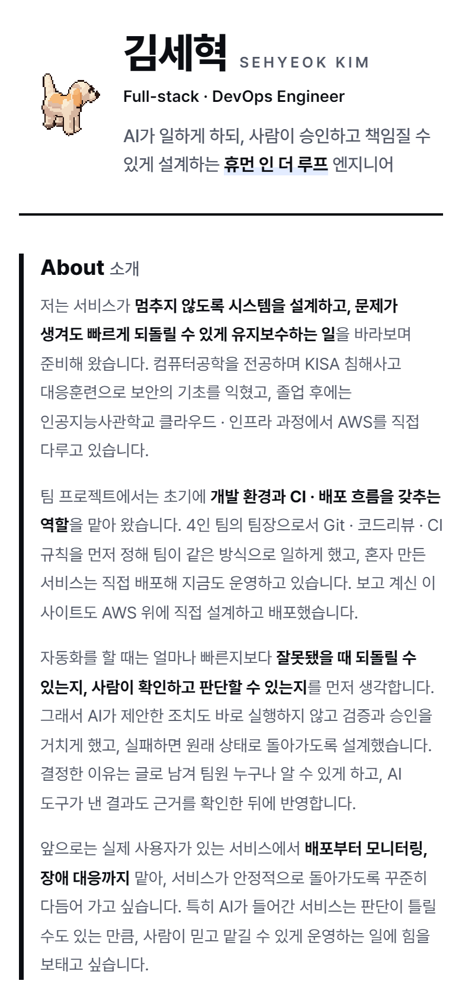
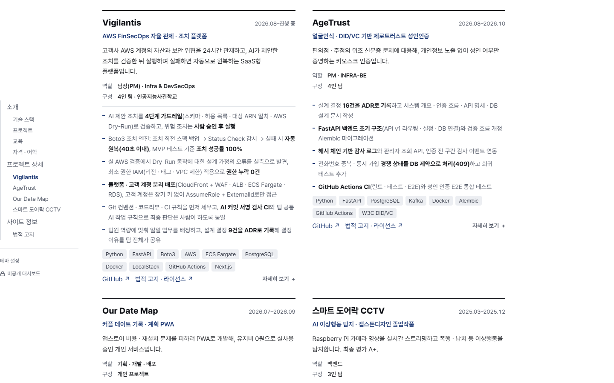
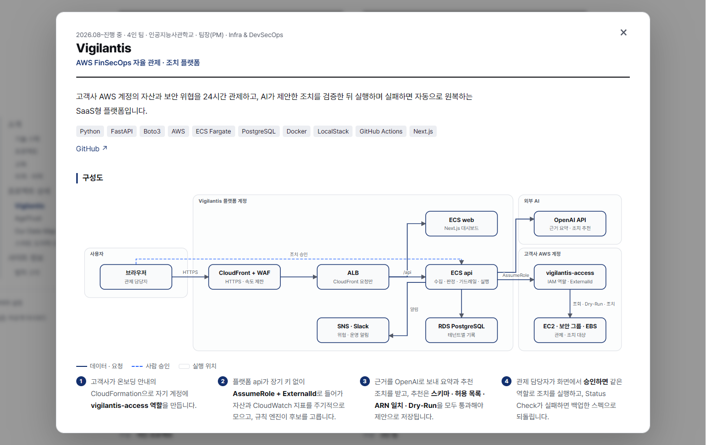
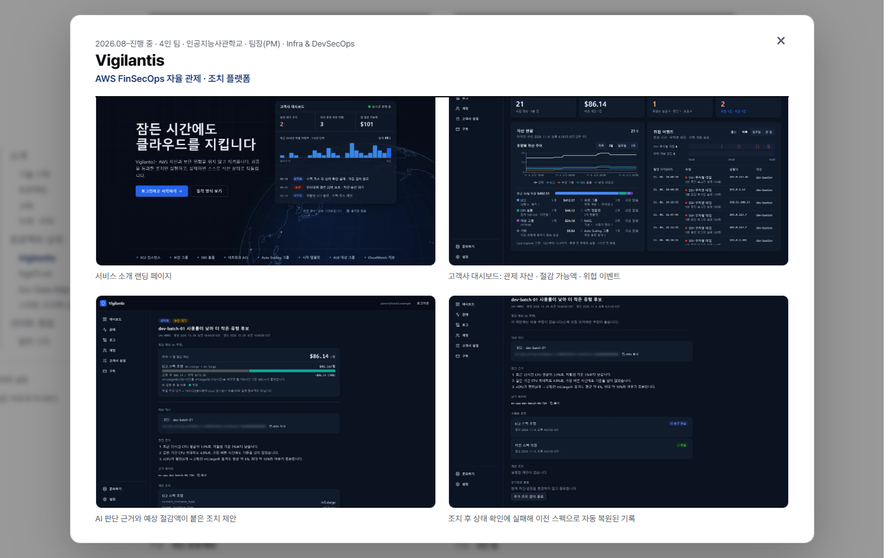
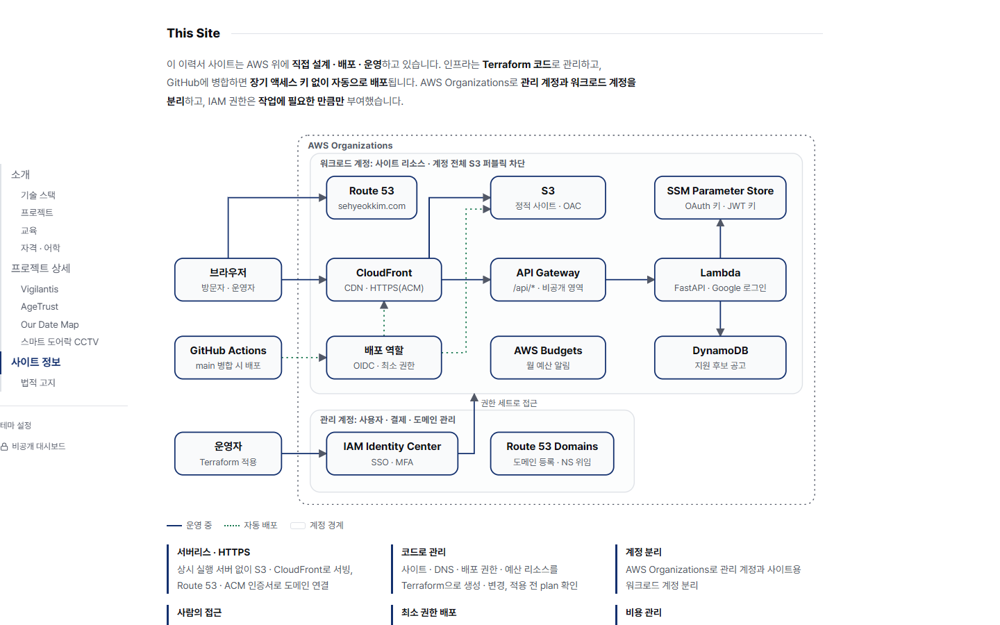
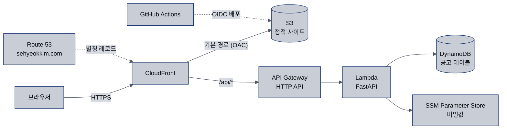
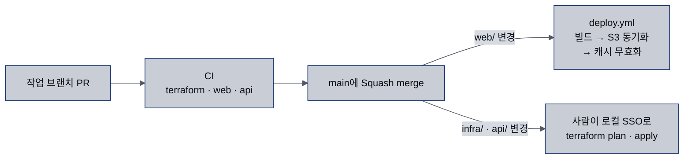

# sehyeokkim.com

이력서·포트폴리오 사이트입니다. 사이트 자체를 AWS 위에 직접 설계·배포·운영하며, 이 저장소에 그 과정(IaC, CI/CD, 보안, 비용 관리)을 기록합니다.

사이트: https://sehyeokkim.com

## 목차

- [화면](#화면)
- [스크린샷](#스크린샷)
- [아키텍처](#아키텍처)
- [저장소 구조](#저장소-구조)
- [배포 흐름](#배포-흐름)
- [기술 스택](#기술-스택)
- [설계 결정 (ADR)](#설계-결정-adr)
- [보안](#보안)
- [비용 관리](#비용-관리)

## 화면

| 주소 | 화면 |
|---|---|
| `/` | 공개 이력서. 프로필, 기술, 자격, 소개, 프로젝트 4개, 이 사이트의 구성 |
| `/` 프로젝트 카드의 "자세히 보기" | 프로젝트 상세 창. 개요, 구성도, 실행 화면, 단계별 설명 |
| `/private/` | 비공개 대시보드. 사이트 주인만 로그인해서 쓰는 개인용 화면 |

공개 이력서는 왼쪽 목차에서 섹션으로 이동하고, 목차 아래 "테마 설정"에서 시스템 · 라이트 · 다크를 고릅니다. 모바일에서는 한 단으로 바뀝니다. 이메일을 누르면 메일 앱 대신 주소가 복사됩니다.

프로젝트마다 카드 하나에 역할, 구성, 주요 작업, 기술, 링크를 둡니다. "자세히 보기"를 누르면 상세 창이 열리고 구성도와 실행 화면 캡처를 볼 수 있습니다. 구성도는 `web/content/resume.ts`의 격자 좌표로 그립니다.

이력서 맨 아래 "This Site"는 이 사이트의 AWS 구성(계정 구조, 워크로드 계정 안의 리소스, 배포 · 접근 경로)을 한 그림으로 설명합니다.

비공개 대시보드는 사이트 주인 한 명만 Google 로그인으로 들어가는 개인용 화면이고, 검색 엔진에서는 제외합니다.

## 스크린샷

<table>
  <tr>
    <td width="36%"><br><sub>공개 이력서 (라이트)</sub></td>
    <td width="36%"><br><sub>공개 이력서 (다크)</sub></td>
    <td width="28%" rowspan="3" valign="top"><br><sub>모바일</sub></td>
  </tr>
  <tr>
    <td><br><sub>프로젝트 카드</sub></td>
    <td><br><sub>프로젝트 상세 창: 구성도</sub></td>
  </tr>
  <tr>
    <td><br><sub>프로젝트 상세 창: 실행 화면</sub></td>
    <td><br><sub>This Site: 이 사이트의 AWS 구성</sub></td>
  </tr>
</table>

## 아키텍처



CloudFront 하나 아래에 정적 사이트와 API를 함께 둡니다. 브라우저가 보기에 화면과 API가 같은 출처라서 CORS 없이 httpOnly 쿠키로 로그인 세션을 주고받습니다 ([ADR 0003](docs/adr/0003-cloudfront-single-origin-cookie-auth.md)). 상시 실행 서버 없이 S3 · CloudFront · Lambda · DynamoDB 온디맨드만 씁니다 ([ADR 0002](docs/adr/0002-serverless-static-site.md)).

도메인 등록은 관리 계정에서, 호스팅 영역 · 인증서 · 레코드는 워크로드 계정의 Terraform에서 관리하고 네임서버 위임으로 연결합니다. `www`는 루트 도메인으로 301 리다이렉트합니다 ([ADR 0007](docs/adr/0007-domain-registrar-and-dns-split.md)).

### 요청 경로

| 요청 | 처리 |
|---|---|
| 페이지 (`/`, `/private/` 등) | CloudFront Function이 폴더 경로에 `index.html`을 붙이고, S3에서 정적 파일을 읽어 응답 |
| API (`/api/*`) | 캐시 없이 API Gateway로 전달. Lambda가 세션 쿠키를 확인한 뒤 DynamoDB를 읽거나 바꿈 |
| 없는 페이지 | S3의 403 · 404를 CloudFront가 `/404.html`로 바꿈 |

API 엔드포인트와 응답 형식은 [API 명세](docs/api.md)에 있습니다.

## 저장소 구조

```
web/                        Next.js 정적 사이트 (output: 'export')
├─ app/page.tsx             공개 이력서
├─ app/private/             비공개 대시보드 (noindex)
├─ app/components/          화면 구성 요소 (구성도, 테마 설정 등)
├─ content/                 이력서 내용(resume.ts), 법적 고지, 아이콘
└─ public/                  이미지, robots.txt

api/                        Python Lambda (FastAPI + Mangum)
├─ app/main.py              라우터: 로그인 · 로그아웃 · 세션 확인 · 공고 조회 · 상태 변경
├─ app/auth.py              Google OIDC 검증, 세션 JWT 발급 · 확인
├─ app/jobs.py              DynamoDB 공고 테이블 읽기 · 쓰기
├─ app/config.py            SSM Parameter Store에서 비밀값 읽기
├─ scripts/build_lambda.py  Lambda 배포 패키지(arm64 zip) 만들기
├─ scripts/load_jobs.py     공고 JSON 검사 후 승인하면 DynamoDB에 적재
└─ tests/                   pytest

infra/                      Terraform
├─ bootstrap/               처음 한 번: state 버킷, GitHub OIDC 배포 역할, 권한 상한선, 예산, 계정 안전장치
├─ modules/site/            S3 버킷, CloudFront 배포 · Function, OAC, 보안 응답 헤더
├─ modules/api/             API Gateway HTTP API, Lambda, DynamoDB, 로그 그룹, 실행 역할
├─ modules/dns/             Route 53 호스팅 영역, ACM 인증서, 별칭 레코드
├─ modules/budget/          AWS Budgets 월 예산 · 알림
└─ envs/prod/               site · api · dns 모듈을 묶은 운영 환경

data/sample/                공개 데모용 가짜 공고 데이터
docs/                       API 명세(api.md), AWS 계정 보안 기준, ADR, README 이미지
.github/                    CI(PR 검사), 배포 워크플로, Dependabot, PR 템플릿
```

## 배포 흐름



| 단계 | 하는 일 |
|---|---|
| CI (`ci.yml`, PR마다) | `terraform fmt` · `validate`, 웹 `lint` · `typecheck` · `build`, API `pytest`와 Lambda 패키지 빌드. AWS에는 접근하지 않음 |
| 배포 (`deploy.yml`, `main`의 `web/` 변경) | OIDC로 임시 자격 증명을 받아 S3에 올리고 CloudFront 캐시를 비움. `_next/static`은 1년 캐시, HTML은 매번 새로 확인 |
| 인프라 · Lambda 코드 | PR에서 plan을 확인한 뒤 사람이 로컬 SSO로 apply ([ADR 0006](docs/adr/0006-manual-infra-apply.md)) |

## 기술 스택

| 구분 | 사용 기술 |
|---|---|
| 웹 | Next.js (정적 export), React, TypeScript, Pretendard 글꼴 |
| API | Python 3.12, FastAPI + Mangum (Lambda arm64), PyJWT |
| 데이터 | DynamoDB (온디맨드, TTL) |
| 인프라 | Terraform (S3 백엔드, `use_lockfile`), AWS `ap-northeast-2`, CloudFront용 ACM은 `us-east-1` |
| CI/CD | GitHub Actions + OIDC (장기 액세스 키 없음), Dependabot |

## 설계 결정 (ADR)

`docs/adr/`에 배경 · 결정 · 대안 · 결과를 기록합니다.

| 번호 | 결정 |
|---|---|
| [0001](docs/adr/0001-github-flow.md) | 브랜치 전략: GitHub Flow + Squash merge |
| [0002](docs/adr/0002-serverless-static-site.md) | 서버리스(S3 + CloudFront + Lambda) 선택 |
| [0003](docs/adr/0003-cloudfront-single-origin-cookie-auth.md) | CloudFront 단일 출처 + httpOnly 쿠키 인증 |
| [0004](docs/adr/0004-github-actions-oidc.md) | GitHub Actions OIDC 배포와 최소 권한 배포 역할 |
| [0005](docs/adr/0005-cost-limits.md) | 비용 제한 원칙 |
| [0006](docs/adr/0006-manual-infra-apply.md) | 인프라 변경은 사람이 적용하고, CI는 웹 파일만 배포 |
| [0007](docs/adr/0007-domain-registrar-and-dns-split.md) | 도메인 등록은 관리 계정, DNS는 워크로드 계정 |
| [0008](docs/adr/0008-google-login-session.md) | 비공개 영역 로그인은 Google OIDC, 허용 계정 1개만 통과 |

## 보안

| 항목 | 내용 |
|---|---|
| 멀티 계정 | 결제 · 사용자 관리용 관리 계정과 사이트 리소스용 워크로드 계정을 분리했습니다. |
| SSO + MFA | 사람은 IAM Identity Center로만 접근합니다. IAM 사용자와 장기 액세스 키는 0개입니다. 루트 사용자는 MFA를 등록하고 일상 작업에 쓰지 않습니다. |
| 배포 | 배포 역할은 OIDC 임시 자격 증명으로 `main` 브랜치의 `production` 환경에서만 맡을 수 있고, 사이트 버킷 파일 쓰기와 CloudFront 캐시 무효화 외에는 권한이 없습니다. 인프라 변경은 PR에서 plan을 확인한 뒤 SSO로 직접 적용합니다. |
| 비공개 영역 | 허용된 Google 계정 하나만 로그인하고, 세션은 httpOnly 쿠키로 주고받습니다. API Gateway에 요청 수 제한을 둡니다 ([ADR 0008](docs/adr/0008-google-login-session.md)). |
| 앱 권한 | Lambda 실행 역할은 권한 상한선 안에서 공고 테이블 읽기 · 지원 상태 변경과 비밀값 읽기만 합니다. 비밀값은 SSM Parameter Store SecureString에 두고 코드 · 저장소에는 두지 않습니다. |
| 계정 안전장치 | 계정 전체 S3 퍼블릭 차단과 IAM Access Analyzer(외부 공유 감지)를 켰습니다. |
| 의존성 | GitHub Action은 커밋 SHA로 고정하고, Dependabot이 주 1회 업데이트 PR을 만듭니다(메이저 업데이트는 분리). 취약점이 공개된 의존성은 바로 PR로 받습니다. |

자세한 기준은 [AWS 계정 보안 기준](docs/aws-account-setup.md)에 있습니다.

## 비용 관리

상시 실행 리소스 없이 사용한 만큼만 과금되는 서비스만 쓰고, AWS Budgets로 월 5달러 예산에 실제 지출 50% · 100%, 예상 지출 100% 알림을 걸었습니다. 고정 비용은 도메인 등록(연 16달러)과 Route 53 호스팅 영역(월 0.50달러)뿐입니다. ACM 공인 인증서와 CloudFront 별칭 레코드 조회는 무료입니다. 쓰는 서비스와 만들지 않는 리소스는 [ADR 0005](docs/adr/0005-cost-limits.md)에 정리했습니다.
